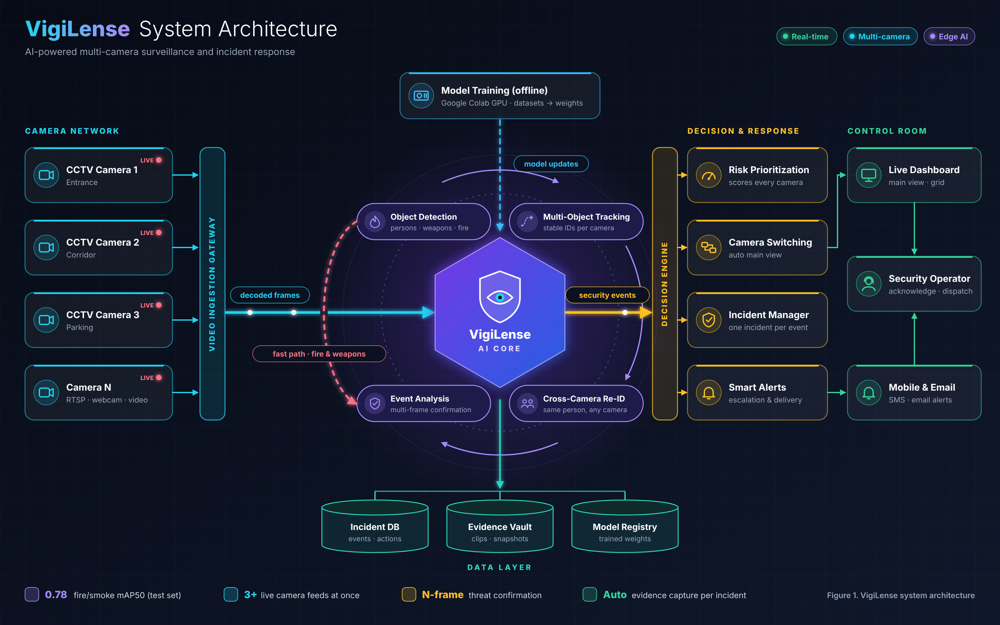
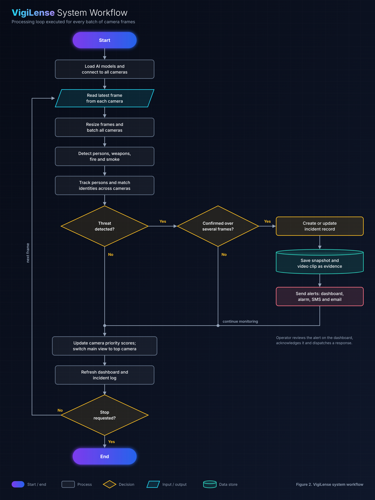

# VigiLense — Architecture

PNG files are high resolution (for Word and slides); SVG files scale to any size.

## Figure 1. System architecture

The AI Core sits at the centre: live video flows in from the camera network, security events flow out to the
decision engine and control room, models arrive from offline training, and everything is recorded in the data layer.

- **Camera network** – CCTV/IP cameras (RTSP), webcams or video files feed the video ingestion gateway.
- **AI Core** – object detection → multi-object tracking → cross-camera re-ID → event analysis (multi-frame confirmation); fire and weapon detections take a fast path straight to event analysis.
- **Decision engine** – risk prioritization, automatic camera switching, incident manager, smart alerts.
- **Control room** – live dashboard, SMS and email alerts, security operator.
- **Model training (offline)** – Google Colab GPU; model updates delivered to the AI Core.
- **Data layer** – incident DB, evidence vault (clips, snapshots), model registry.

## Figure 2. System workflow

1. Load AI models and connect to all cameras.
2. Read the latest frame from each camera; resize and batch the frames.
3. Detect persons, weapons, fire and smoke; track persons and match identities across cameras.
4. No threat → continue monitoring.
5. Threat → check it is confirmed over several frames (filters one-frame false alarms).
6. Confirmed → create/update the incident, save a snapshot and video clip, send alerts (dashboard, alarm, SMS, email).
7. Update camera priority scores, switch the main view to the highest-risk camera, refresh the dashboard.
8. Repeat for the next frames until stopped.
