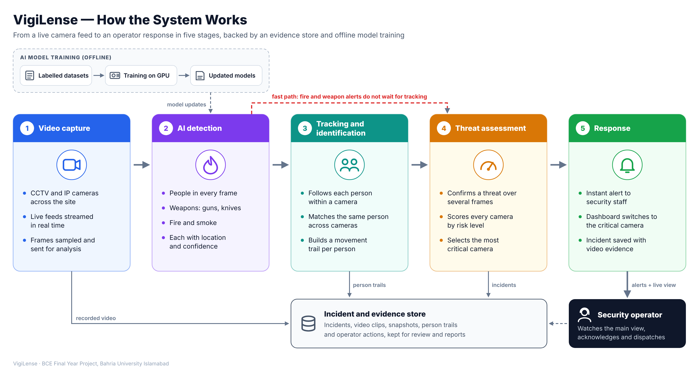
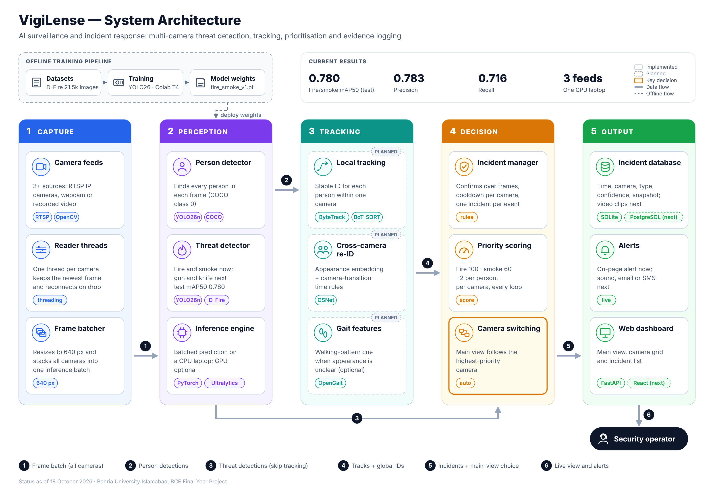

# VigiLense — Architecture

Diagrams of the VigiLense system for the FYP report and presentations.
PNG files are high resolution (for Word and slides); SVG files scale to any size.

## 1. How the system works (overview)

VigiLense turns live camera feeds into prioritised alerts in five stages:

1. **Video capture** – CCTV and IP cameras stream live feeds; frames are sampled for analysis.
2. **AI detection** – people, weapons (gun, knife), fire and smoke, each with a location and confidence.
3. **Tracking and identification** – each person is followed within a camera and matched across cameras.
4. **Threat assessment** – threats are confirmed over several frames, every camera is scored by risk, and the most critical camera is selected.
5. **Response** – staff are alerted, the dashboard switches to the critical camera, and the incident is saved with video evidence.

Fire and weapon detections take a **fast path** straight to threat assessment, so urgent alerts never wait for tracking.
All incidents, clips, person trails and operator actions are kept in the **incident and evidence store**.
AI models are **trained offline** on a GPU and pushed back to the detection stage.

## 2. Detailed module architecture

Five layers — Capture, Perception, Tracking, Decision, Output — with the technology used in each module,
the offline training pipeline, numbered data flows, and the build status of each module (dashed = planned).

## Files

| File | Use |
|---|---|
| `vigilense_how_it_works.png` / `.svg` | System overview figure (introduction chapter) |
| `vigilense_architecture.png` / `.svg` | Detailed module architecture (design chapter) |
